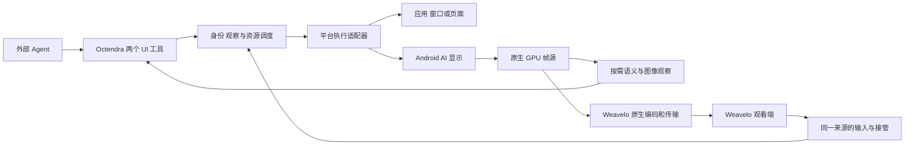

# Octendra 和 Weavelo 平台操作技术方案

日期：2026-11-02。目标是让外部 AI 使用一套接口操作电脑、手机和网页，同时让用户继续使用自己的设备。平台执行与恢复由 Octendra 负责，实时画面、交互与接管由 Weavelo 负责；规划和业务确认继续属于调用它们的 Agent。

本方案的交付物是设计和两份任务单：[Octendra 任务](tasks/octendra-ui-platform.md)、[Weavelo 任务](tasks/weavelo-ui-platform.md)。本轮不修改 Weavelo 实现、不部署设备、不启动联合测试。联合测试由用户最终安排，各项目先完成自己的验证和汇报。

## 当前基线和完成状态

Octendra 源码基线为 8a3e4e5，Weavelo 对照源码为 03f0f20。Octendra 已实现 ui_observe / ui_act、操作去重、原生窗口坐标映射，以及 Android 的初步后台显示和语义适配。此前独立模拟器验收通过 92 项，Rust 库测试通过 500 项，Android 单测通过 28 项。它们证明的是对应实现和测试场景，不证明下面的新机制已实现，也不代表新代码已经全量部署。

| 能力 | 当前已确认 | 本方案需要补齐 |
| --- | --- | --- |
| 通用入口 | 两个工具及已有连接授权 | 应用选择、局部观察、具体动作能力和结果校验 |
| 桌面后台操作 | macOS 有面向进程的事件路径；Windows 主要是 UIA 点击；Linux 主要是观察 | AX / UIA / AT-SPI 语义树和语义动作 |
| Android 后台屏 | 独立显示标志检查、显示身份、图像和部分输入已在模拟器验证 | 显示组保活、输入法串扰、应用分身、主屏外溢和任务收尾 |
| 并发状态 | 原生设备级锁；同一 owner/device 只保留最新原生观察；Android 按 view 保留最新观察 | 独立不可变观察、应用实例级调度及跨客户端协调 |
| Weavelo Android | 现有主屏 MediaProjection、Surface HEVC 编码和输入路径 | AI 后台屏来源、共享执行后端、GPU 图像分流和接管 |
| 恢复和发布 | 现有日志、请求身份及升级脚本 | 真机长期恢复、已授权服务恢复、签名包和全部节点的运行身份核验 |

## Mika 的平台机制和取舍

本次对照 Mika v0.1.33，提交 ebb0e44750d80aabb6b642c69908825d6b1a8107。之前移植依据是 v0.1.30 的 29307104，因此应按下面的机制逐项核对，不能把旧版的局部移植当作新版能力覆盖。[Mika 源码](https://github.com/wangzan101/Mika/tree/ebb0e44750d80aabb6b642c69908825d6b1a8107)

| 机制 | 实现要点 | 对我们的决定 |
| --- | --- | --- |
| 可信后台显示 | shell UID helper 持有 VirtualDisplay；独立内容、显示组、焦点及禁止抢顶层焦点各有不同作用 | 保留已有真实 UID 和 Binder 边界；创建后检查实际能力。没有独立焦点时不能声称不干扰主屏 |
| 显示组保活 | OWN_DISPLAY_GROUP 有独立息屏计时；合成输入不一定算用户活动，Mika 定向刷新该显示组活跃状态 | 补后台屏长期活跃检查；不使用整机常亮替代。停止使用时结束保活 |
| 输入法和事件路由 | IME 策略、手势、按键都要绑定显示；键盘投递与触摸投递的等待语义不同 | 每次提交校验目标应用、显示和输入连接；独立焦点不等于两个软键盘可以独立输入 |
| 应用实例 | 以 package 与 Android user/profile 区分应用分身和工作资料 | 优先识别系统已有、可用的另一份应用；不复制登录数据、不自动创建资料或解锁私密空间 |
| 主屏外溢 | App 打开的深链、选择器或新任务可能落到主屏；Mika 结合动作时间、原主屏任务和用户点击判断归属 | 只纠正明确由 AI 动作引起、仍归 AI 的页面。用户接管过的界面和系统认证页面不能直接拉走 |
| 应用任务收尾 | 先决定保留任务，隐藏后移动并放到主屏任务栈后方，再释放虚拟屏；重新打开时恢复同一任务 | 正常完成尽量保留停留页。移动机制不可用时保持明确的后台状态，不静默销毁用户工作 |
| 音频和剪贴板 | 包与 user 级音频原值记录；剪贴板先保存，再确认仍是本次写入的内容才恢复 | 只恢复本任务拥有的改动；用户后来复制或改变音频设置时不得覆盖 |
| 网页后台宿主 | 私有 VirtualDisplay 中挂载自己的 WebView，使其真正布局和渲染；Cookie 持久化，页面可交给用户再交回 | 自有网页可采用应用内宿主；它不能承载任意第三方 App，也不自动拥有 Chrome 的登录态 |
| 观察和效果判断 | 语义树、OCR、局部图像变化与事件安静状态结合；特殊滚轮和网页编辑器有适配 | 引入目标范围内的读回与变化证据，保留原始操作身份；不把画面变化当作业务成功 |
| helper 和服务恢复 | 进程死亡、Binder 断开、已授权无障碍服务及调试连接分别恢复；恢复意愿与运行状态分开 | 复用已有本地启用意愿和 OS 授权。用户明确停止后不重新启用；恢复完成重新观察，不重放动作 |

对应源码：[ShellService](https://github.com/wangzan101/Mika/blob/ebb0e44750d80aabb6b642c69908825d6b1a8107/app/src/main/java/com/wangzan101/mika/cap/phone/shell/ShellService.kt)、[DisplayAwake](https://github.com/wangzan101/Mika/blob/ebb0e44750d80aabb6b642c69908825d6b1a8107/app/src/main/java/com/wangzan101/mika/cap/phone/shell/DisplayAwake.kt)、[AppCopies](https://github.com/wangzan101/Mika/blob/ebb0e44750d80aabb6b642c69908825d6b1a8107/core/src/main/kotlin/com/wangzan101/mika/core/uistate/AppCopies.kt)、[MainScreenSpill](https://github.com/wangzan101/Mika/blob/ebb0e44750d80aabb6b642c69908825d6b1a8107/app/src/main/java/com/wangzan101/mika/cap/phone/a11y/MainScreenSpill.kt)、[AppsAfterTask](https://github.com/wangzan101/Mika/blob/ebb0e44750d80aabb6b642c69908825d6b1a8107/app/src/main/java/com/wangzan101/mika/cap/phone/shell/AppsAfterTask.kt)。

Mika 的兼容退路和产品策略应逐项选择。它允许去掉 trusted 标志重试、存在保留页数量和时间策略，并包含自身模型循环、确认和浏览节奏；这些不直接成为我们的限制。动作 I/O 需要可终止的等待，但不能因此给外部 AI 的思考、任务时长或迭代次数增加门槛。

Mika 的桌面网页模式还调整 UA、UA-CH、视口及部分页面可见的 WebView 特征。这是需要单独评估的兼容实现，不能据此承诺规避验证码或账户风控。首期采用持久、已授权的真实浏览器会话；桌面显示模式用于页面布局需要，不默认移植一套浏览器伪装脚本。[DesktopProfile](https://github.com/wangzan101/Mika/blob/ebb0e44750d80aabb6b642c69908825d6b1a8107/app/src/main/java/com/wangzan101/mika/cap/web/cdp/DesktopProfile.kt)

## 平台实现路径

| 平台 | 首选执行路径 | 需要更强隔离时 | 必须如实表达的边界 |
| --- | --- | --- | --- |
| Android | 既有授权 helper 的可信 AI 显示、按显示的语义树及输入 | 系统已有的应用分身或工作资料；自己的网页使用私有 WebView 宿主 | Android 版本与 OEM 权限、IME、任务启动和受保护页面不同；一个虚拟屏不是一份新账号 |
| macOS | AX 语义操作、按窗口抓图；已有 PID 事件只用于实际可验证的操作 | 任务确实需要独立全局输入时，可使用已有 VM；Apple silicon 上可研究官方 Virtualization 路径 | Spaces 或额外显示器不提供第二套通用键鼠；应用可能自行激活或共享内部状态 |
| Windows | UIA 的 Invoke、Value、Selection、Toggle 等语义能力，配合现有窗口抓图 | 需要独立原始输入时采用独立来宾或已有独立会话 | 新建 Desktop 不代表获得第二个活动输入桌面；不修改 UIPI、UAC 或会话限制 |
| Linux | 当前图形会话的 AT-SPI；按 X11 / Wayland 实际能力选择截图 | 新启动的任务 App 可使用独立嵌套 compositor 或已有来宾 | 额外 output 不等于独立 seat；既有 App 不能普遍迁入新 compositor；原生 Wayland 不假装拥有全局输入 |
| 无图形会话的 NAS 和 Linux 节点 | 继续文件、命令与已有浏览器接口 | 有实际 GUI 任务时才准备相应会话 | 不因接入了节点就报告桌面可用；离线设备记为待验证 |
| iOS 等新增平台 | 单独建立公开 API 和授权范围的适配评估 | 依据该平台实际提供的会话或测试机制 | 本方案不把 Android helper、隐藏接口或虚拟屏机制宣称为通用能力 |

独立来宾和 compositor 是解决具体无法后台执行的任务的可选扩展，首期不在每台设备铺设虚拟机。现有宿主已能用语义方式完成的任务直接执行。Mika 并未实现上述桌面平台适配。

平台依据：[Android IME](https://source.android.com/docs/core/display/multi_display/ime-support)、[Android 多显示](https://source.android.com/docs/core/display/multi_display/displays)、[Windows Desktop](https://learn.microsoft.com/en-us/windows/win32/winstation/desktops)、[Weston 后端](https://wayland.pages.freedesktop.org/weston/toc/running-weston.html)、[Apple silicon macOS VM](https://developer.apple.com/documentation/virtualization/running-macos-in-a-virtual-machine-on-apple-silicon)。

## 对外接口

继续使用 ui_observe 和 ui_act。下面是待实现的最小扩展；当前严格参数校验尚不接受这些新增字段，必须同步服务端 schema、Agent 及文档后才能调用。

```json
{"tool":"ui_observe","arguments":{"device":"Android-Phone","view":"background","target":{"app":"微信","instance":"工作资料"}}}
```

```json
{"tool":"ui_observe","arguments":{"device":"Mac-Studio","target":{"app":"Safari","window":"采购清单"}}}
```

```json
{"tool":"ui_act","arguments":{"device":"Mac-Studio","observation_id":"<returned UUID>","action":{"type":"fill","target":{"ref":"n12"},"text":"采购数量"},"expect":{"type":"value_equals","target":{"ref":"n12"},"value":"采购数量"}}}
```

- target 是可选选择条件，首期为 app、window 和 instance；instance 选择已发现的系统应用实例或浏览器 profile。应用重名时返回候选，不猜测执行目标。页面来源通过返回的具体 view 继续选择。
- view 的 active 和 background 是便捷入口，返回值必须是已解析的真实 view。background 表达后台使用意图；适配器返回实际隔离程度，不能把语义后台控制冒充独立桌面。
- ui_observe 增加可选 query，按文本、角色或已有 ref 缩小观察范围；通过可选 observation_id 查询仍保存的观察时不触发新的系统输入，也不覆盖其他观察。
- ui_act 继续默认返回后续观察；expect 可选，首期只支持目标值、文本、选中状态、目标关闭及界面变化等有明确证据的条件，不提供任意脚本条件。expect 的目标来自原观察；后续验证按真实元素身份重新定位，不能把同名序号直接套到新树上。
- type_text 是在选区插入，fill 是替换字段。选中、勾选、展开等新增动作按真实语义实现；重复 fill 或 set_checked 已满足时不再次触发操作。不能照搬其他项目中名字相似但含义不同的方法。
- 使用既有账户、设备和本地执行授权。session、调度、内部租约、原生句柄和重试序号由服务维护，不增加调用方手动开会话、续期、切模式或逐动作确认。

## 身份和状态

执行上下文由既有连接解析，不由 AI 填原生 PID 或 UID。

| 字段 | 含义和更新时机 |
| --- | --- |
| device_id | 既有注册设备身份 |
| app_instance | 平台账户或 profile、应用身份、进程实例；Android 至少包含 package 与 user，不能只用 package |
| view_id | 具体窗口、页面、后台显示或隔离会话的逻辑身份 |
| generation | 原生来源重建、helper 重启或视图实例替换时变化，不能用新原生 ID 接受旧输入 |
| source_revision | 画面尺寸、旋转、裁剪、显示或窗口映射变化时更新，复用 Weavelo 既有来源修订 |
| resource_epoch | 同一资源发生修改、控制归属变化或影响操作的状态变化时更新，不按视频帧递增 |
| observation_id | 不可变观察及其元素引用、图像映射和资源版本；不同对话可同时保存 |
| operation_id | 复用既有持久化操作身份和去重结果；连接恢复后仍查询原操作 |

资源调度按实际干扰范围进行：Android 应用实例及所属显示，桌面默认按应用进程，CDP 网页按 page target；共享浏览器外壳和全局物理输入使用更大的公共资源范围。独立读取可并发，缓存查询不占输入通道。需要维持原生对象身份的操作仍遵守适配器线程约束。

同一资源的修改保持顺序，投递前消耗当前操作所依据的版本。无效引用返回新观察和未投递结果。已投递但未知结果的操作只查询和读回，不通过新 idempotency_key 再点一次。读取、光标闪烁和无关动画不提升整个设备的资源版本；异步 UI 变化在目标范围内重新核验。资源锁用于防止输入串到另一任务，不是新增业务审批。

已有 generation、revision、epoch 能表达的地方直接复用；不为每层再增加一组版本号。agent-desktop 的同用户全局写锁不能直接删除：采用其 CLI / FFI 时必须尊重原有锁，把实际并发限制反映出来；需要更细并发时对被证明独立的原生语义调用做受测适配。[FFI 并发约定](https://github.com/vercel-labs/agent-desktop/blob/9eb9b296192fcb70bda25e918cd6dd66abfa3d0d/skills/agent-desktop-ffi/references/threading.md)

## Android 后台执行

### 显示和电源

复用 ShellUiContext、IUiShell 和 BackgroundView。创建后读取真实 Display 标志、显示组、尺寸和旋转。SDK 版本只是能力线索；trusted、独立焦点、IME 路由和显示状态需要分别核验，并以系统版本、系统构建和 helper 身份为能力缓存边界。

补充显示组级活跃保持：只针对任务拥有的独立显示组，跟随显示创建与释放启动和停止；系统只提供整机活跃接口时报告缺失，不把主屏改成常亮。区分空显示未出帧、显示休眠、渲染停滞、受保护内容和 helper 已丢失，避免统一报权限错误。

主屏熄灭、设备锁屏、用户首次解锁和 AI 显示可用是不同状态。ALWAYS_UNLOCKED 标志不等于解锁物理设备或解密尚未解锁的资料。按实际系统授权继续，不能以黑帧宣称已完成操作。

### 输入和输入法

Android 的软键盘并不天然为每块显示提供完全独立的一套会话。优先使用目标控件语义写入；当前输入连接必须同时匹配目标显示、应用和编辑控件。WebView、富文本、自绘输入分别选择可验证的路线，不把对任意当前 InputConnection 的 commitText 当作后台输入保证。

已有授权情况下，投递时同时绑定显示与目标窗口或 UID，并在按下与释放之间跟踪状态。取消、来源变化或断线释放本次持有的键和触点。Home、最近任务、电源和音量不能只因事件带 displayId 就声明为显示内动作；无法保证局部语义时不在该 view 广告支持，或改为明确的本地任务操作。

需要粘贴时，先确认能够读取并保存原剪贴板；投递到明确目标后读回，再仅在剪贴板仍属于本次写入时恢复。密码输入不经剪贴板。用户在主屏中文组词期间，后台操作不得提交到该输入连接、清空组词或抢走软键盘。后者必须在两部真机验证，不能由模拟器文本测试替代。

### 应用启动和主屏外溢

应用实例选择、占用检查与启动在同一资源事务中完成。枚举系统已有且已运行、已解锁、属于当前资料关系的应用分身；不把其他 user 下同名 package 当成同一份应用。启动后核验 task 的真实 user、应用和 display。已有页面尽量恢复同一 task，而不是每次重新启动首页。

围绕一次可能跳转的动作，记录主屏原任务、任务到达来源和用户交互时间，不记录用户输入内容。只有能归因到本动作且用户未接管的新任务才考虑移动。系统认证、选择器和已经被用户操作的界面有单独结果；不能通过重发原深链来强行重建页面，否则会改变调用者和认证上下文。

### 收尾和局部状态恢复

正常完成时保留应用当前页面，优先用经验证的隐藏、移动和重排方式停放到用户任务栈后方，并核验主屏焦点未变化。移动不支持时保留明确的后台来源和可恢复状态，不用突然激活主屏或直接释放 DESTROY_CONTENT_ON_REMOVAL 的显示代替收尾。

按 app_instance 记录本任务修改的音频状态，不调整整机音量，不影响用户正在使用的同一实例。音频需要发布时协调本地静音与编码来源，不能把 App 静音后仍承诺可采集其声音。恢复只处理本任务的改动，并检查是否已有更新的用户意图。正在播放内容默认保留还是关闭由用户任务意图决定，不复制 Mika 的固定默认策略。

helper 丢失后重建 generation，旧引用全部失效。已授权服务恢复区分断连、暂未绑定、系统回收、用户停止和首次授权缺失；只有既有本地启用意愿仍有效时自动修复。保留其他无障碍服务列表和现有设备注册。USB 拔插、Wi-Fi 改变、进程死亡、重启首次解锁分别验收。

## 网页会话和原生语义

桌面采用 AX / UIA / AT-SPI 提供语义观察和控件动作，原有像素与窗口事件路径保留给实际需要的界面。agent-desktop 是候选原生后端，pi-computer-use 的资源调度和不可变状态模式可选择性移植；两者都不作为新的模型运行时或额外账户体系。导入代码保留 Apache 2.0、MIT 及相关第三方声明，并按现有平台构建和签名方式交付。

已有连接和 OS 授权继续有效使用。底层若仍把执行记录绑定到每次变化的二进制哈希，签名兼容升级需要同步续接已授权记录，不能升级一次就要求用户重新批准任务或手动绑定窗口。原生目标身份和签名检查保留，真正尚未取得的 OS 授权单独表达。

浏览器优先使用已有授权且可控制的实际浏览器；需要托管会话时按既有连接维护持久 profile。用户当前使用的 profile 不能同时被第二个进程打开，不复制私有 Cookie 数据库。Android 自有 WebView 的私有显示宿主可减少对 shell / 无障碍的依赖，但只操作自己的网页内容；普通第三方 App 仍走应用执行路径。现有接口能满足时直接复用，只有实测定位到网页渲染或会话控制缺口时才新增私有宿主。

登录会话保存在对应原生应用或 profile；页面借出、人工接管和交回尽量保持同一页面对象、历史和滚动位置。浏览器崩溃后持久 Cookie 可保留登录，但不能宣称未提交的页面内存状态一定恢复。验证码、真实登录失效和服务退避有明确状态及续接位置，不进入反复刷新和重登录循环。

观察使用语义树、必要的图像和 OCR。OCR 节点标记为像素证据，不伪装成原生可执行句柄。树截断时允许在目标区域继续观察。效果判断优先目标值、选择状态或页面变化；事件安静与局部图像变化辅助判断，视频和动画不应阻塞观察。控件读回成功与业务提交成功分开报告。

## Octendra 与 Weavelo 的边界



Octendra 拥有 Android AI 显示、helper、应用任务及执行语义；Weavelo 拥有媒体需求、编码、传输、呈现与人工手势。Weavelo 操作 AI 显示时调用同一个平台执行服务，不再自行向默认显示发送一套无关事件。桌面复用现有窗口来源和本地集成路径，增加语义操作与输入归属，不另造网络控制层。

Android 跨 App 接口沿用本机 Binder / Surface。根据真实 Binder 调用 UID、预期包名和已配置的签名身份识别 Weavelo；不能假定两个 App 使用相同证书而只写 signature permission，也不能只信请求里自报的包名。签名判断覆盖系统认可的签名轮换关系，升级不新增业务授权。MCP 和局域网不公开裸 helper 端口。

内部接口至少覆盖：列出可提供的 view 描述、绑定某一 generation 的媒体 Surface、按来源修订提交输入、获取来源状态、归还绑定与观察来源丢失。每个返回值沿用同一 device、view、generation、source_revision 与资源版本；错误明确区分未投递和结果未知。具体 AIDL 与跨平台结构由 O1 和 W1 联合定义一次。

拟定的 Android 接口边界如下。名称和序列化由双方按此语义一次落实，参数不经模型填写。

```text
describeViews() -> ViewDescriptor[]
attachVideo(view_id, generation, encoder_surface, format, callback) -> consumer_id
detachVideo(consumer_id)
dispatchInput(consumer_id, generation, source_revision, resource_epoch,
              event_id, typed_input) -> existing_input_receipt
releasePressed(consumer_id)
callback.sourceChanged(ViewDescriptor)
callback.sourceLost(view_id, generation, reason)
callback.controlChanged(view_id, resource_epoch, actor)
```

ViewDescriptor 至少包含上下文身份、应用实例、名称和图标、原生尺寸与旋转、内容矩形、可执行动作及焦点影响。format 使用协商得到的编码尺寸、帧率和颜色信息，不由应用名称猜测。跨 Binder 只传 Surface、输入与元数据，不传逐帧像素；原生线程负责帧处理，不阻塞 App 主线程。

consumer_id 是本机已验证调用者的绑定，不能由另一 UID 使用；调用者死亡只清理其媒体绑定和所持输入。event_id 复用现有输入序列身份，接管与来源失效时拒绝旧上下文。只有尚未投递的连续移动事件可按现有实时通道语义合并；文本、按下、释放和触点取消保持顺序。输入回执仍区分投递与实际效果。

Rust 语义类型、MCP schema 和 Android 测试样例以既有 desktop protocol 与 adapter-contract 生成入口对账；Weavelo 只做自己来源及输入协议的映射。不能让两个仓库各自发明同名字段、单位或坐标原点。

错误按发生阶段返回：来源不存在或已重建、映射变化、资源正在使用、不支持动作、实际 OS 授权不足、未投递、结果未知和纯观察超时。纯观察超时允许重试读取，不能误报某个业务输入已经产生未知效果；未知动作则返回原 operation_id 查询路径。后台重新绑定和只读恢复可以内部重试，可能已生效的输入不能自动重发。

### 媒体和坐标

一个 VirtualDisplay 输出 Surface 不能直接同时交给 ImageReader 与编码器各自当独立消费者。流媒体接入采用一个 SurfaceTexture / EGL 帧入口：GPU 渲染到 Weavelo MediaCodec 输入 Surface；AI 只有明确观察时才读回所需图像并编码。现有 ImageReader 路径可以作为实现过渡，但不能把每帧 Bitmap 复制、缩略图或 MCP 轮询当作最终视频方案。

帧入口由拥有显示的 Octendra 适配层维护，Weavelo 通过受验证 Binder 绑定编码器 Surface；编码器由 Weavelo 管理。观看端退出只解绑其消费者，不销毁 AI 任务。显示或应用来源重建才改变 view 的 generation；观看者来去不改变该身份。几何变化更新 source_revision，编码配置变化复用 Weavelo 既有的编码代际和关键帧机制。

继续复用 SurfaceHevcEncoder、原生媒体传输与接收呈现。保留真实色彩元数据、编码器对齐与背压语义。坐标共享逻辑统一处理内容矩形、缩放、裁剪、DPI、旋转和键盘 inset；图片坐标或视频触点只反向映射一次。几何变化取消尚未完成的旧手势。

### 人工接管

人工输入和 AI 语义动作进入同一来源的资源协调。人工接管使该资源版本变化，取消冲突的待发 AI 输入并释放 AI 持有的键和触点；其他应用继续运行。Weavelo 手动交互来源提供明确归属，本地 OS 事件只使用已获授权、能可靠获得的元数据；缺少输入监测权限时不声称可以判断一切人工行为。

归还依据既有观看窗口交互焦点、来源切换或外部 Agent 的继续指令处理。AI 恢复时先观察，不继续使用接管前的 ref。无需给每次动作增加“申请控制权”弹窗，也不设置固定思考时限。用户持续操作同一资源时，如实返回资源正在人工使用，而不是竞争焦点。

## 任务和依赖

| 顺序 | Octendra | Weavelo | 可独立验证的结果 |
| --- | --- | --- | --- |
| 1 | O1 通用上下文、不可变观察及资源调度 | W1 来源与输入协议映射 | 不同对话不覆盖观察；身份、代际和坐标字段一致 |
| 2 | O2 显示保活、IME 与按显示输入 | W2 AI 来源的原生帧与编码连接 | 后台长时间可操作；编码 Surface 可以独立绑定和解绑 |
| 3 | O3 实例选择、外溢与任务收尾 | W3 共享执行和人工接管 | 同包不同 user 不混淆，用户前台状态保持，接管不误投 |
| 4 | O4 桌面语义适配；O5 持久网页上下文 | W4 用户界面与来源切换 | 用户按应用选择，AI 和人看到同一真实来源与操作结果 |
| 5 | O6 进程和系统恢复；O7 按平台隔离扩展评估 | W5 媒体恢复、画质与性能 | 断线无重放，来源恢复明确，呈现与输入实测 |
| 持续 | O8 签名、节点升级与运行验收 | W6 各端交付与独立验收 | 每个节点有实际运行身份和检查结果 |

O4、O5 可在 O1 后独立推进；O6 可与媒体接入并行。W2 依赖 O2 的来源寿命和 Surface 接口，W3 依赖 O1/O3 的归属与应用实例。O7 只为已证明无法通过现有后台语义路径完成的任务实现具体隔离后端，不阻塞先交付的正确能力。

显示保活、明确目标的输入检查和恢复诊断可先在现有接口上小步修复，不等待 O1 的全部结构调整。每一阶段先交付一个可实际操作的完整场景，再扩展动作与平台覆盖，避免为了搭通用框架延迟已定位问题的修正。

两个仓库都使用主 main 和各自唯一主工作目录。共享协议文件同一时刻只有一个写入任务，另一项目按已提交协议适配；不创建功能分支、额外 worktree 或合并流程。每个小迭代完成相关检查后显式提交、推送并核验远端，兼容升级直接进行，不等待全计划结束，也不增加发布门禁。现有签名、构建缓存、安装入口和在途操作继续复用。

## 验证和交付

| 场景 | 必须观察的实际结果 |
| --- | --- |
| 用户应用 A 与 AI 应用 B 同时使用 | 前台窗口、真实光标、剪贴板及用户文本未被 B 改动；B 的目标结果正确 |
| 两个对话或 Agent | 不同资源可推进；同资源写入有序；一方读操作不覆盖另一方的观察 |
| Android 独立屏 | 空屏、首次启动、熄屏计时、旋转、键盘变化和长时间运行区分明确，无主屏焦点外溢 |
| 两部手机输入 | 中文组词、选区、长文本、WebView 和自绘输入分别验证；后台输入不提交到主屏编辑器 |
| 应用实例与任务 | 已有分身的 user 正确；没有分身记不适用；深链、系统选择器、完成页保留和重开接续有证据 |
| 人工接管 | 旧 AI 输入不再落地，其他资源继续；归还后重新观察；无悬挂按键或触点 |
| 故障恢复 | USB 拔插、切网、服务回收、helper 死亡和设备重启分开验证；原操作不重复，用户停止后不自启 |
| 媒体和几何 | 实际首帧、解码、屏上呈现、触点与画面重合；色彩、裁剪、缩放、旋转和背压保持正确 |
| 性能 | 记录观察与操作往返、实际呈现耗时、CPU、内存和返回 token，和既有同任务基线比较，不捏造目标速度 |

优先做适配逻辑和故障注入的独立测试，再用每项目自有的专用窗口、页面和模拟器验证；真实两手机、macOS、Windows、Linux 的验收单独记录。没有系统分身、设备离线、缺少图形会话或 OS 拒绝的情况明确列出，不能算通过，也不能归结为统一的权限错误。跨项目联合测试在用户安排后执行。

升级复用 Mac Studio 主构建和既有 Android / macOS 签名路径。Gateway 先于 Agent；Weavelo 按其既有构建和安装入口升级。任何升级都观察原操作结果后再继续，不重放结果不明的升级。正在被另一对话测试的设备先协调时机，避免中断在途工作。

节点清单必须从当前 inventory 对账，至少覆盖 NAS Gateway、Mac Studio、MacBook、cube、HO5、Reachy Mini、RPi 400、两部 Android，以及这些设备上存在的 Codex / Antigravity MCP 与 Skill 文档。网页版连接分别核验实际工具目录和一次业务调用，不能只看授权成功。

报告分别列出源码提交与远端状态、测试、包与签名、安装、运行哈希、实际操作、恢复及尚未完成的节点。全部升级的判定依据运行身份与功能结果，不能只依据版本号、源码推送、安装命令返回或模拟器测试。

## 上游代码采用

Mika 采用选定的显示、任务、恢复和输入适配代码；agent-desktop 作为桌面语义后端候选；pi-computer-use 采用资源调度、观察和效果证据设计。优先复用稳定边界，并保留对应许可证和来源。媒体逐帧数据走 Weavelo，工具结果和稀疏图像走 Octendra。外部 Agent 保持唯一业务循环。

不导入第二套模型账号、任务确认系统、用户必须操作的低级会话流程，也不默认复制上游的页面限额、留页 TTL、打字节奏或浏览器特征修改。真正的 OS 权限、签名身份、数据归属和输入目标保持准确，失败直接定位到具体平台边界并修复。
