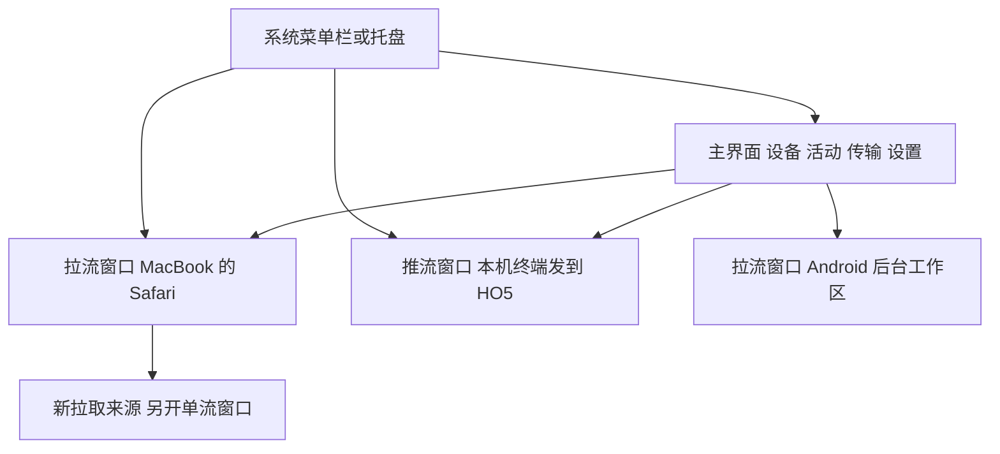

# Weavelo 主界面和单流远控窗口规划

日期：2026-11-02。Weavelo 的设备管理、全局设置与远控画面分开。主界面统筹设备和正在进行的任务，每个远控窗口只绑定一路推流或拉流，多窗口可以并行；macOS 系统菜单栏图标及 Windows / Linux 托盘提供无需打开主界面的快捷操作。

这是界面和交互规划。本次只在 Octendra 仓库记录方案，不改动正在由另一对话维护的 Weavelo 实现。实施时沿用 remote_play 的原生 GPUI、现有设计系统、后台服务、媒体和签名路径。

## 窗口职责

| 界面 | 主要职责 | 默认展示 |
| --- | --- | --- |
| 主界面 | 设备列表、设备快捷操作、活动总览、传输中心、配对和设置 | 启动后直接显示设备，常用操作就在设备旁边 |
| 拉流窗口 | 一路远端来源的观看与控制 | 具体设备、应用或显示及完整画面 |
| 推流窗口 | 一路本机来源发送给一个对端的控制与状态 | 本机来源、目标设备、发送状态与需要时的预览 |
| 菜单栏或托盘 | 状态、打开窗口、快速访问设备、发文件和停止发送 | 当前活动与常用设备 |

这里的单流指一个窗口拥有一个固定的流上下文，不限制整个产品只能有一路流。连接中、暂停、断线重连和来源结束的状态仍属于该上下文，不自动切换到另一设备。



## 主界面

保留现有深色、青色强调、紧凑控件和原生字体层级，将设备管理从画面上的抽屉改成主界面内容。远控窗口继续以画面为主体。

```text
Weavelo                                      添加设备   搜索
设备   活动   传输   设置

常用设备
MacBook     在线 · 接收 2 路       查看画面   发送画面   文件   …
HO5         在线 · 发送 1 路       查看画面   发送画面   文件   …
Android     在线                  查看画面   发送画面   文件   …

全部设备                  在线 / 活动中 / 全部
设备名称、平台、连接状态、活动摘要和快捷操作
```

主导航只保留设备、活动、传输、设置四项。配对、设备组和设备名称在设置或对应设备详情中，添加设备仍可直接从顶部进入。当前网络与共享状态有简短状态入口，详细诊断按需打开。

本机共享与 OS 授权放在本机设置中；对端缺少能力时展示对端状态和真实可用的处理入口，不把本机权限页当作远端设置。推流窗口的本机录屏或相机问题也明确标为本机问题。

设备列表使用一致的四组操作：

- 查看画面：来源仍有效时可复用最近查看的来源；否则打开该设备的来源选择器。不把已经失效的应用窗口静默替换成整块桌面。
- 发送画面：选择本机的显示、窗口或相机，发送给明确的目标设备，创建或聚焦相应推流窗口。
- 文件：直接打开该设备的文件与传输上下文，不要求先拉一条视频流。
- 更多：设备详情、名称、配对信息、已有共享与权限入口、复制现有接收命令、查看该设备活动等。实际连接级断开明确显示其影响的流数量。

点击设备名称查看设备详情，不把普通选择变成意外发起控制。常用设备和最近设备沿用真实设备身份，排序变化不能改变按钮的执行目标。离线设备仍可查看本地详情与历史，在线操作显示具体不可用原因。

活动页列出全部推流、拉流和传输；点击流卡片聚焦对应窗口。原有多窗口工作区能力迁移为活动总览、来源多选与独立窗口编排，保留同时使用多路来源的能力。网格预览可在总览按需保留，实际交互进入相应单流窗口，不在单流窗口里再嵌多个可竞争输入的流。

## 单流远控窗口

窗口标题固定说明设备、方向和来源。例如“MacBook · Safari · 接收”和“本机终端 → HO5 · 发送”。来源变化时标题和图标随已确认的来源一起变化，不先展示尚未成功切换的名称。

主体继续使用当前原生视频呈现、纵横比、缩放、全屏和遥测方式。设备列表、配对和全局设置移到主界面；当前设备的文件、来源、输入和画面设置通过统一操作栏的局部面板打开。

```text
MacBook · Safari · 接收

  MacBook ↓ Safari   控制   文件   新画面   声音   显示   …

                   远端画面

  按需显示连接状态与遥测
```

统一操作栏指每个远控窗口使用同一个组件和操作定义，并始终绑定本窗口的设备与流；主界面和菜单栏也调用相同操作。不使用可被其他窗口改写的全局当前设备。

### 操作栏内容

| 分组 | 常用操作 | 详细入口和范围 |
| --- | --- | --- |
| 身份 | 设备、发送或接收方向、应用或来源 | 在线状态、来源信息、跳到该设备详情 |
| 控制 | 控制或仅观看、当前输入状态 | 文字与物理键模式、实际支持的触控方式、人工接管或归还 |
| 文件 | 向当前设备发送文件、查看传输 | 已发布文件与拉取、接收目录、当前设备的任务及已有取消操作 |
| 新画面 | 拉取当前设备的新窗口、显示或相机 | 默认另开单流窗口；需要替换时使用明确的替换当前画面操作 |
| 声音 | 接收声音或既有麦克风共享 | 保留当前可用、开启、静音和不可用状态；范围按底层实际能力说明 |
| 显示 | 适应或填充、全屏 | 分辨率、FPS、码率、自定义值、暂停、已有非活跃窗口策略、PiP 与遥测 |
| 更多 | 剪贴板、发送本机画面到此设备、设备详情、诊断、结束此流 | 影响整台设备或全部会话的操作必须以明确名称区别 |

主栏保持少量固定分组，低频功能进入相应面板。小窗口保留身份、控制、文件和更多，其余折叠但不丢功能。全屏支持现有自动隐藏；菜单、输入框或文件选择器打开时不能自动收起正在使用的操作面板。

### 推流和拉流的差异

拉流窗口的控制按钮针对远端来源，声音按钮控制该流的播放。推流窗口的身份必须说明本机来源和接收设备，主要操作是更换或新增本机发送来源、已有控制共享状态、发送参数、暂停和停止发送。不能把推流预览上的点击误当作控制接收设备。

两个方向都可以向对应设备发文件或从它再拉一个窗口；新建的反方向流出现在另一个窗口。麦克风、剪贴板和共享权限若实际属于整个设备连接，界面说明该范围，不能伪装成只影响一个画面。连接级设置与流级参数分别更新。

同一本机来源可以继续发给多个对端，各推流窗口绑定自己的接收设备。停止其中一路只撤掉该对端的发送，仍被其他接收者使用的捕获和编码继续由现有后台所有者维护。

### 新画面与来源选择

在 MacBook 的 Safari 窗口选择新画面，来源选择器直接查询 MacBook，不重新选设备。可选择一个或多个来源，每个来源生成独立窗口；已打开同一逻辑来源时默认聚焦已有主窗口，避免误开重复接收和编码。

明确选择替换当前画面才修改该窗口的来源。切换期间沿用现有来源身份、revision、手势取消和确认逻辑；失败时保留可解释的原状态，不改成别的设备或默认来源。相机和 AI 后台显示使用同一来源选择入口，能力由实际来源返回。

### 文件与输入焦点

文件面板默认筛选当前设备，并显示明确的目标名称。发送、发布、拉取、接收目录、翻页和取消保留。全局传输中心聚合相同任务，不复制出第二套传输生命周期。

拖文件到远控窗口时显示发送给哪台设备，沿用现有文件协议；不把普通传文件假装成已经拖进远端应用。打开本地文件选择器或操作栏输入框时，按键属于本地界面，不能继续透传到远端。恢复控制时重新核验该窗口的输入上下文。

## 关闭和后台行为

| 操作 | 结果 |
| --- | --- |
| 关闭主界面 | 隐藏或关闭管理窗口，远控、发送、文件传输和后台在线继续 |
| 关闭拉流窗口 | 释放该窗口的输入；同流若仍有 PiP 等展示端则保持，最后一个展示端关闭后停止该路订阅 |
| 关闭 PiP | 只关闭 PiP，不停止仍有主窗口的流 |
| 关闭推流控制窗口 | 关闭预览或控制界面，后台继续发送；菜单栏仍显示该发送活动并可重新打开 |
| 结束此流或停止发送 | 结束明确的这一路流和它的展示端；保留其他流及文件任务 |
| 退出 Weavelo | 沿用既有完整退出流程，清楚显示这是全应用操作 |

临时断线保持原窗口和设备身份，显示正在恢复；不新建重复窗口，不自动切到另一设备。最小化、窗口失焦和主界面被激活按现有每流策略处理，不能因为管理窗口没有画面或菜单栏打开，就暂停所有流。

## 菜单栏和托盘

macOS 使用现有系统菜单栏图标，Windows / Linux 使用现有托盘。移动端使用应用内快捷入口和已有前台服务通知，不硬套桌面 menubar。

```text
Weavelo · 接收 2 路 · 发送 1 路
打开主界面

正在接收
  MacBook · Safari                 打开 / 暂停 / 结束此流
  Android · 后台工作区             打开 / 结束此流
正在发送
  本机终端 → HO5                  打开预览 / 停止发送

常用设备
  MacBook                         查看画面 / 发送画面 / 文件
  HO5                             查看画面 / 发送画面 / 文件

发送文件到…
传输中心
共享与设置
停止全部发送（1 路）
退出 Weavelo
```

首期使用原生菜单和子菜单实现以上入口。桌面上的拖文件到菜单栏图标属于后续增强，先验证原生行为和收益，不阻塞基本快捷操作。

菜单数据来自既有后台服务的设备和活动快照；没有 GUI 时也能显示真实状态。打开菜单时固定所选设备或流的身份，点击后核验其仍有效，避免菜单刷新导致目标错位。暂停、结束和打开均带明确上下文，不能只给服务发送“操作当前连接”。

需要文件对话框或来源选择时，先激活或创建现有前端，再把同一动作送到对应设备上下文；仅为显示 UI 不新建第二个后台运行时。发送命令保留原请求身份，前端激活重试不能重复发送文件。

菜单栏状态来自事件更新，不随每一视频帧刷新。进行中的来源保留完整访问入口，常用设备按用户固定和最近使用展示；完整列表回到主界面。

## 现有功能的去向

以下是当前源码中已定位的功能。实施时以实际入口和对应处理器逐项迁移、验证；只在旧设计文档出现而未实现的能力不能当成已完成的功能。

| 已定位功能 | 新位置 | 保留要求 |
| --- | --- | --- |
| 设备列表、筛选、名称编辑、查看、发送、文件与复制接收命令 | 主界面设备页，常用动作进入菜单栏 | 保留真实设备身份和原操作入口 |
| 设备组、邀请码或配对码、二维码与图片导入 | 主界面添加设备与设置 | 保留注册、密钥和已有配对数据 |
| 本机共享状态及 OS 权限信息 | 主界面共享设置，远控更多提供定向跳转 | 不重置系统权限或增加逐操作审批 |
| 显示、应用窗口与相机选择，切换相机 | 新画面和明确的替换当前画面 | 来源确认、图标、标题、选择状态与错误保持一致 |
| 多窗口工作区、并发来源 | 活动总览、来源多选和独立窗口编排 | 保留并发能力，单流窗口不混入其他来源 |
| 文件发送、发布、共享文件刷新、拉取、分页、接收目录与取消 | 当前设备文件面板及全局传输中心 | 传输不依赖视频窗口寿命，保留已有请求与校验 |
| 控制锁定、文字输入、物理键模式、IME | 控制分组和对应窗口输入层 | 中文输入、本地快捷键和远端按键不串窗口 |
| Android 直触与触控板 | 移动远控页的控制分组 | 不把仅有设计稿的其他模式宣称为已实现 |
| 麦克风、声音、剪贴板 | 对应分组或更多 | 按实际设备或流范围操作，保留可用性和当前状态 |
| 分辨率、FPS、码率及自定义值 | 显示分组；默认值在主界面设置 | 单流调整与保存为默认区分，不误改其他流 |
| 暂停、非活跃策略、Fit / Fill、全屏、最小化、PiP | 显示与窗口操作 | 保留现有原生呈现、窗口行为和独立状态 |
| 连接、带宽、RTT、媒体与延迟遥测 | 当前流的遥测面板，主界面活动摘要 | 数据绑定同一来源，实际呈现与仅解码分开 |
| 后台在线、打开与完整退出 | 后台服务、菜单栏与对应窗口 | 关管理窗口不退出后台，不启动重复网络所有者 |

源码依据为 remote_play 对照提交 051b4fe 的 app/src/restored_ui.rs、workspace_ui.rs、desktop/device_list.rs、tray.rs 与 tray/{mac,windows,linux}.rs，以及 Android 的 WorkspaceScreen 和 MobileViewportScreen。当前 tray 动作主要是 Open / Quit，设备管理和流状态集中在 RestoredDashboard，因此需要先拆职责再迁移控件。

## 实现结构

继续由现有后台服务持有设备组、连接、发布和托盘；既有 GUI 前端负责原生视频解码和呈现，不把媒体搬到另一套渲染引擎。

在现有 owner / session 模型上划清三个所有权范围：

- 应用范围：设备、全局偏好、活动与传输状态、窗口登记。MainWindow 只订阅管理状态，不按视频帧重绘全部设备。
- 流范围：固定的设备、方向、逻辑来源、当前原生代际、媒体设置、输入状态和错误。StreamController 不依赖管理窗口存在，可由主窗口和 PiP 共同引用。
- 展示范围：窗口边界、全屏、焦点、工具栏和呈现资源。关闭一个展示端不误销毁其他展示端或传输任务。

窗口登记按逻辑流身份查找并聚焦，网络恢复后的原生连接 ID 变化不制造新窗口。每一路流的接收、发布与文件任务继续使用既有连接和操作身份，不因多个 UI 窗口增加重复网络运行时。

操作复用已有 reducer 和 effect，统一携带作用域：AppAction、DeviceAction(device_id)、StreamAction(stream_id)。主界面、远控栏和菜单栏调用同一动作处理路径。菜单栏打开造成焦点变化时，不重新猜测其操作对象；共享侧通道按实际连接范围显示。无需新建插件式命令框架或另一套授权系统。

## 移动端适配

Android 入口分为设备和设置主页面，以及一个绑定具体流的远控页面。横屏延续画面优先，竖屏将统一操作栏折叠为紧凑分组或底部操作面板，保留直触、触控板、文字输入、声音、文件和来源选择。

需要新来源时可创建新的逻辑流，并在主页面的活动列表切换到各自远控页面；普通手机不假装拥有桌面式多窗口。多窗能力仅在平台实际支持时使用。系统授权、后台服务通知和文件选择继续复用当前平台机制。

## 交付顺序

| 任务 | 内容 | 独立验证 |
| --- | --- | --- |
| U1 | 逐项登记现有入口与处理器，明确应用、设备、流和展示的状态所有权 | 两个设备、两个窗口的动作不会串目标；已有功能都有去向 |
| U2 | 提取管理主界面和设备快捷动作，保留现有远控可用 | 管理窗口关闭后远控、发送和传输继续 |
| U3 | 拆出固定单流窗口，绑定标题、输入、媒体、PiP 和恢复 | 同设备不同来源、多设备多窗口及推拉并行均保持身份 |
| U4 | 统一操作栏与当前设备局部面板 | 文件、新画面、所有旧功能和本地输入焦点逐项通过 |
| U5 | 扩展原生菜单栏或托盘，复用相同动作 | 无 GUI 时能打开正确上下文，菜单更新不重复或错发操作 |
| U6 | Android 页面职责适配、真实视觉与运行验收 | 窄窗、全屏、移动横竖屏、重连、主界面关闭及多窗口均正常 |

U1 到 U5 先在桌面形成完整链路，随后落到各平台原生 UI；后台协议和媒体内核保持既有入口。与平台操作计划的 W1/W2/W3 共享来源身份和输入归属，UI 不等待所有 AI 后台屏能力完成才交付；尚未接入的来源如实显示实际能力。

在各仓库唯一主 main 工作目录小步实现和检查，完成可用迭代后提交、推送及核验；不增加功能分支、额外 worktree 或新的审批流程。新旧架构不并排长留，按既有生产入口逐步替换职责并保持可运行。

## 验收和完成标准

- 实际检查 macOS、Windows、Linux 的管理主界面、接收、发送、PiP、菜单栏或托盘，以及 Android 主页面和远控横竖屏。截图与真实交互分别记录。
- 至少两个对端、每端不同来源同时存在。切换主界面选择、另一窗口焦点或菜单栏状态后，文件、输入、参数和结束动作仍命中原目标。
- 新拉来源不替换旧流；明确替换时正确取消旧输入和更新映射。来源消失、网络恢复和暂停后不串源，不重复建窗口。
- 主界面关闭、推流预览关闭、拉流最后展示端关闭、PiP 关闭和全应用退出符合上面的生命周期表。文件任务跨这些界面继续正确运行。
- 原生画质、色彩、DPI、触点映射、IME、声音和已有恢复行为与当前基线对比，不能用布局改造交换性能或功能退化。
- 复用现有签名、正式构建与安装方式；实际运行版本和全部设备升级单独对账。规划完成、文档提交和本地渲染不代表已部署。

各项目先独立测试和汇报，不中断另一对话正在进行的设备任务；跨项目联合测试仍由用户安排。
